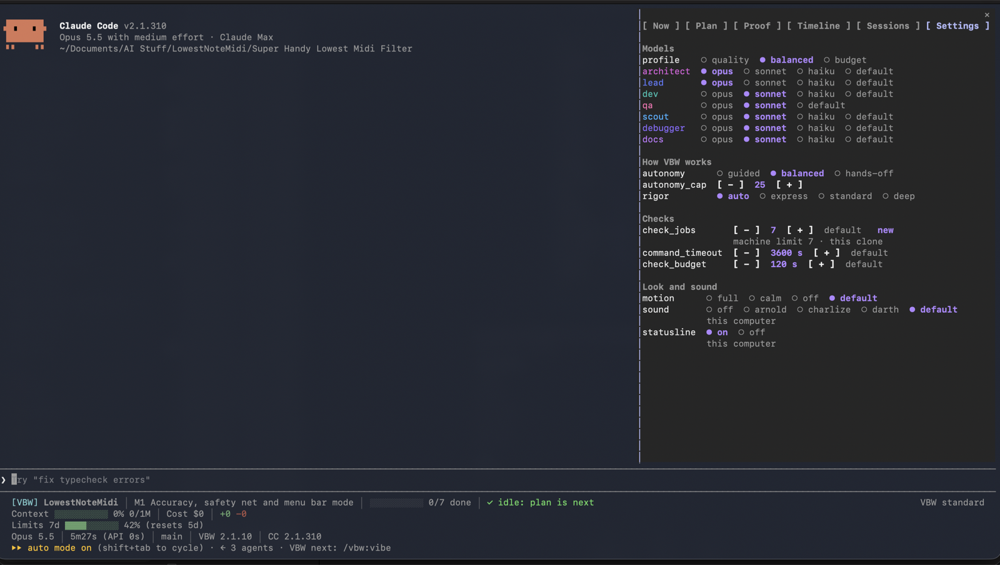

<div align="center">

# Vibe Better With Claude Code - VBW

**Requires Claude Code 2.1.286 or newer, running Sonnet, Opus or Fable.**

*You're not an engineer anymore.*

*You're a prompt jockey with commit access.*

*At least do it properly.*


[](LICENSE)
[](https://code.claude.com)
[](https://anthropic.com)
[](https://discord.gg/zh6pV53SaP)

</div>

<p align="center">
<a href="#what-is-this">What is this</a> ·
<a href="#install">Install</a> ·
<a href="#start">Start</a> ·
<a href="#features">Features</a> ·
<a href="#commands">Commands</a> ·
<a href="#how-it-stays-safe">Safety</a> ·
<a href="#configuration">Configuration</a> ·
<a href="#requirements">Requirements</a> ·
<a href="#documentation">Docs</a>
</p>

<p align="center"></p>

## What Is This?

> **Platform:** macOS and Linux. Windows is not supported natively: VBW runs on bash. On Windows, run Claude Code inside [WSL](https://learn.microsoft.com/en-us/windows/wsl/install).

VBW 2 is a rewrite of VBW 1, in philosophy and execution. It is built so you pay once for work that is right: every requirement is proven by a check before it ships, so you spend less over time finding, fixing and redoing what broke. [How VBW thinks about cost](#cost).

### For people who don't read code, and people who do

You do not need to read code to use VBW. You describe what you want, answer questions in plain words and judge what only a person can judge. If you do read code, you get the contract, the checks and a git history to review.

VBW is a Claude Code plugin that works as a harness around the model: it builds what you asked for, then proves it works before anyone is allowed to say "done". A requirement counts as done only when an approved check passes on a clean copy of the code, or when you accept it.

### The problem

***Vibe coders***: You've shipped an app you can't read, written by an AI you can't question, tested by no one. You know it works because the AI told you so.

***Seasoned devs***: You've spent years writing tests nobody ran for specs nobody approved, and now you have to trust 4,000 lines a model wrote in minutes.

### What VBW does about it

You type `/vbw:vibe` and what you want. VBW runs the loop below and stops only when it needs you. And ulinke VBW 1, you type this only once, then chat with Claude Code as you'd usually do. Advanced users have granular controls.

**Meet the team.** Each is an AI agent with one job, and VBW runs as many of them at once as the work allows: a milestone with ten independent plans gets ten Devs building side by side, then a QA reviewer for every finished phase at the same time.

| Agent | Job | How many |
| :--- | :--- | :--- |
| **Architect** | Works out the decisions only you should make (cost, data, security, anything hard to undo), then splits the work into **phases** (a goal each). Writes nothing. | 1, thinking the whole milestone through |
| **Lead** | Turns each phase into small **plans**: a few tasks, their own files. Writes the tests first and makes sure they fail today (*red*). | 1, planning every phase of the milestone |
| **Dev** | Writes the code for one plan, one commit per task, until its tests pass (*green*). At standard and deep rigor it also breaks its own code on purpose, to confirm a test notices. Also fixes what fails later. | One for every plan, multiple plans in tandem, all at the same time: VBW sets no limit (only plans that touch the same files wait for each other) |
| **QA** | Reads a finished phase against its goal and reports what's wrong. Never touches the code. | One for every finished phase, all at the same time |
| **Scout** | Looks things up, one angle each: your code, the web, the docs. Reports with sources; changes nothing. | Up to 4 at the same time, one per angle |
| **Debugger** | Reproduces a bug, finds the root cause, then makes the smallest fix plus a test that proves it. | 3 at the same time to investigate, then 1 to fix |
| **Docs** | Writes the README, guides and changelog. Documentation files only. | One for every documentation plan, working alongside the Devs |

**Who's the boss?** No agent. The Lead's plans decide what gets built; the kernel decides how it runs: how many Devs work at once (as many as there are ready plans that share no files) and how much checking each phase gets (one Dev for a typo, the full team for payments code). Management by a program.

```text
  STEP                                        PRACTICE
  ┌──────────────────────────────────────┐
  │ /vbw:vibe                            │
  │ First run: sets up .vbw/, asks you   │
  │ 3 questions. Existing code: maps it. │
  └──────────────────────────────────────┘
                     │
                     ▼
  ┌──────────────────────────────────────┐
  │ 1. AGREE                             │    ATDD / Specification by Example
  │ Spec: requirements, each marked      │    Acceptance criteria written
  │ [auto] (a check decides) or [human]  │    before design. Decisions
  │ (you decide). Decisions asked one    │    recorded with their rationale.
  │ at a time.                           │
  └──────────────────────────────────────┘
                     │
                     ▼
  ┌──────────────────────────────────────┐
  │ 2. PLAN                              │    TDD: red
  │ Lead splits each phase into small    │    Every [auto] requirement gets
  │ plans with disjoint files. Writes a  │    an acceptance check (argv, exit
  │ check per [auto] requirement and     │    code), confirmed failing today
  │ runs it: it must fail.               │    for the right reason.
  └──────────────────────────────────────┘
                     │
                     ▼
  ┌──────────────────────────────────────┐    ┌─────────────────────────┐
  │ 3. APPROVE                           │    │ "Not yet": the plan     │
  │ You approve one contract: spec,      │ ◀──│ changes, you're asked   │
  │ plans, checks, test files, commands. │    │ again                   │
  │ Any change to it un-approves it.     │    └─────────────────────────┘
  └──────────────────────────────────────┘    Frozen contract (SHA-256).
                     │                        Check files write-protected
                     │                        by hooks while building.
                     ▼
  ┌──────────────────────────────────────┐
  │ 4. BUILD                             │    TDD: green
  │ Devs build plans in parallel waves,  │    Red verified before the first
  │ each only in its own files. One      │    change. Atomic commits with a
  │ commit per task.                     │    VBW-Plan: provenance trailer.
  └──────────────────────────────────────┘
                     │
                     ▼
  ┌──────────────────────────────────────┐    ┌─────────────────────────┐
  │ 5. PROVE                             │    │ FIX                     │
  │ The kernel runs every approved check │─ ─▶│ Agents fix the code;    │
  │ and the test command on a clean      │fail│ a QA fix adds a test.   │
  │ copy of HEAD, checks each commit     │ ◀──│ 3 failed tries: it      │
  │ stayed in its plan's files, and that │    │ comes to you.           │
  │ what each plan built is still there. │    │                         │
  └──────────────────────────────────────┘    └─────────────────────────┘
                     │                        Executable definition of done.
                     │                        Proof in a detached worktree,
                     │                        evidence in .vbw/record.json.
                     ▼
  ┌──────────────────────────────────────┐    ┌─────────────────────────┐
  │ 6. REVIEW                            │    │ Findings become fixes   │
  │ QA reviews against the goal and      │─ ─▶│ (back to FIX)           │
  │ changes nothing. You judge each      │    └─────────────────────────┘
  │ [human] one, or Skip for now.        │    Goal-backward review.
  └──────────────────────────────────────┘    Manual acceptance testing.
                     │
                     ▼
  ┌──────────────────────────────────────┐
  │ 7. SHIP                              │    Regression suite
  │ More to build: /vbw:vibe again.      │    Every later proof covers every
  │                                      │    check: re-run if a file it
  │                                      │    read changed, reused if not.
  └──────────────────────────────────────┘    Nothing proven breaks quietly.
```

Every stop ends with one line, **What I need from you:**, and the one thing you must do now, or "nothing". You never have to guess whether VBW is waiting for you.

### For engineers: the model proposes, the kernel disposes

VBW 2 is built around a **kernel**: `vbw`, a bash + `jq` + `git` program that the model cannot argue with. Agents do the work; the kernel decides what counts. It's acceptance test-driven development, enforced by code instead of good intentions.

| | Claude Code on its own | Claude Code + the VBW kernel |
| :--- | :--- | :--- |
| **Who says it's done** | The model | The exit code of an approved check, run on a clean copy of `HEAD` |
| **Who can edit the tests** | Anyone, including the agent being tested | Not the building agents: check files are in a SHA-256 contract and write-protected by hooks. A change waits for your approval |
| **Where the state lives** | The chat context, until compaction eats it | `.vbw/record.json`: one writer, locked, validated, atomic |
| **Who runs the process** | The model, improvising | Dynamic workflows: deterministic JavaScript |
| **Parallel agents** | Up to the model | Waves with no shared files; guards deny writes outside each plan |
| **Running repo commands** | Whatever the model types | Argv only, no `eval`, after you consent to the content hash |
| **Several sessions, one folder** | Last write wins | A run's files are leased to its session; everything else stays open |

<p align="center"></p>

Three design choices worth knowing:

- **No per-agent worktrees, on purpose.** A worktree has no `node_modules` or virtualenv, so an agent either reinstalls everything or proves the main checkout's code instead of its own. A false proof is the one failure VBW refuses to have. File-disjoint waves plus guards give the same isolation without it.
- **Proof reuses what didn't change.** VBW records what each check reads while it runs; a check whose definition, last result and every file it read are unchanged keeps its pass. If your test runner can run one test file at a time, say so in the spec's `## Test files` section (`- run: bats {file}` and `- files: tests/*.bats`) and your tests are reused per file too; you approve the form with the contract. `vbw prove --full` re-runs everything.
- **One limit per computer.** Every VBW run on a computer, in any project or session, shares one limit on how many checks and test files run at once (about three quarters of the processor cores), so parallel sessions take turns instead of overloading the machine.

How many agents? One Dev for every plan in a wave, all at the same time, and VBW keeps the wave as wide as the file boundaries allow: ten plans that touch different files means ten Devs at once.

Inspired by **[Ralph](https://github.com/frankbria/ralph-claude-code)** and **[Get Shit Done](https://github.com/glittercowboy/get-shit-done)**; the architecture is new.

---

## Install

Open Claude Code and run these two commands inside the session, **one at a time**:

**Step 1:** Add the marketplace

```text
/plugin marketplace add swt-labs/vibe-better-with-claude-code-vbw
```

**Step 2:** Install the plugin

```text
/plugin install vbw@vbw-marketplace
```

Two commands, two separate inputs. Pasted together, Claude Code reads them as one command and the URL breaks.

Restart Claude Code. VBW turns on what it needs (Dynamic workflows and its status line) the first time you use it. `/vbw:doctor` checks the rest.

### Updating

Run `/vbw:update`. It runs `claude plugin marketplace update vbw-marketplace` and `claude plugin update vbw@vbw-marketplace`, then asks you to run `/reload-plugins` (or restart Claude Code). `/vbw:whats-new` then says what changed; the full history is in [plugin/CHANGELOG.md](plugin/CHANGELOG.md). VBW makes no network call, so nothing tells you a new version is out unless you turn on Claude Code's auto-update for `vbw-marketplace` (`/plugin`, Marketplaces tab, Enable auto-update); `/vbw:doctor` shows whether it is on, and after an update VBW offers `/vbw:whats-new` once. See [docs/update.md](docs/update.md).

### Running VBW

| | **Supervised** (for the cautious) | **Auto** (for the brave) |
| :--- | :--- | :--- |
| **Start with** | `claude` | Sonnet, Opus or Fable, then Shift+Tab for auto mode |
| **Claude Code asks you** | Before file writes and commands, once per tool per project | Only when it must |
| **VBW stops for** | Decisions, approval, checking, shipping | Decisions, approval, checking, shipping |
| **Feels like** | Some clicking in the first session, then smooth | Agents keep building until a step needs you |

Auto mode keeps the flow unbroken: the agents work longer between stops.

> **Disclaimer:** `--dangerously-skip-permissions` turns off Claude Code's permission prompts, and VBW does not make that safe. VBW's guards are guard rails, not a sandbox; the Claude Code sandbox and permission rules remain the security boundary. Read what you approve.

---

## Start

You only need to remember one command. In any git repository, new or existing:

```text
/vbw:vibe I want a command-line expense tracker in Node.js
```

1. **Setup.** The first run sets up the project and the VBW status line.
2. **Questions.** Three about you, once. Then what you are building and for whom, then the decisions that matter, one at a time, each with a recommendation.
3. **Approve.** VBW shows the plan and its checks and asks. Enter approves; **Not yet** or your own words change the plan. Seniors will skim, and both are short enough for that. You can change your mind any time: VBW re-plans without touching finished work.
4. **Build and prove.** Agents build in parallel, then VBW runs the checks and QA reviews each phase against its goal. Failures become fixes; after three failed attempts at one, it comes to you.
5. **Judge what only you can.** For each `[human]` requirement (look, feel, wording) VBW shows the thing to judge and asks: **Works**, **Something's wrong** (VBW fixes it and asks again) or **Skip for now**. A requirement you are not ready to judge can wait: when skipped ones are all that holds up shipping, you choose to ship and judge them in the next milestone, where they keep their id, checks and history.
6. **Ship.** VBW asks whether to ship, then recommends what to do next.

Come back any time and type `/vbw:vibe`: it continues where things stand. Used an earlier VBW in this project? VBW reviews the old folder and recommends converting or starting fresh; you choose ([docs/convert.md](docs/convert.md)).

---

## Features

The loop above is the core. Around it:

| Feature | What you get |
| :--- | :--- |
| **Triage** | Every new idea is sorted into now, next or later, with a size. You confirm or overrule in one menu. [docs/triage.md](docs/triage.md) |
| **What's next** | After each ship, and whenever you ask, the Architect recommends a top pick and up to two runners-up, each with a reason and a size. [docs/whats-next.md](docs/whats-next.md) |
| **Decisions, recorded** | Cost, where data lives, security, anything hard to undo: asked one at a time with a recommendation, recorded with your reason (`vbw show decisions`). When someone asks "who decided this?", the record and git say it was you. |
| **Rigor that fits** | A typo gets one Dev and one approval. Payments or sign-in code gets the full team and deep review. VBW sizes the process from what the work touches, raises the bar when a build goes badly, and tells you why. [docs/rigor.md](docs/rigor.md) |
| **Tests that can fail** | At standard and deep rigor each Dev breaks its own code on purpose (`vbw mutate`), and VBW records whether a check noticed. A test that stays green on broken code is strengthened before the plan can finish. [docs/workflows.md](docs/workflows.md) |
| **Fixes that leave a test behind** | When QA finds a problem, the fix can add a regression test that would have caught it: the Dev writes the test file and registers it with `vbw fix check FIX`. It waits for one approval from you, then runs in every later proof. [docs/proof.md](docs/proof.md) |
| **Failures you can read** | A failing check or project command keeps its full output under `.vbw/runtime/output/`; `vbw show fix` names the file and the failing tests. |
| **Talks at your level** | Three questions, once per project. Beginners get plain words. Seniors get terse output and the trade-offs. [docs/interview.md](docs/interview.md) |
| **Picks up where you left off** | Everything lives in `.vbw/` in your project, not in a chat window. `/vbw:vibe` continues exactly where things stand. |
| **What it cost** | Each run and each milestone is priced from the figures Claude Code gives the status line. `vbw show costs`. [docs/costs.md](docs/costs.md) |
| **Status line and panel** | Progress, what's proven and what VBW needs from you, always visible. On Claude Code 2.1.287+, the panel has Mission Control (the side pane: where the project stands, in plain words) and, from 2.1.290, Comms (the strip above the prompt: the helpers at work, or one line when VBW needs you). Each shows the running step's end time ("about 12 min, until around 14:20"); Mission Control also shows when the milestone should end, and a sound plays when a question needs you (on by default, `/vbw-sound` switches it). [docs/panel.md](docs/panel.md) |

**Rigor that fits**, at a glance: how much checking a phase gets, and what raises it.

<p align="center"></p>

The status line, under the prompt:

```text
[VBW] expenses │ M1 First milestone │ ▓▓▓▓▓▓▓░░░ 4/6 done │ ▶ build P1.2, P2.1 · 1 of 2 · until 14:20
Context ▓▓▓░░░░░░░ 31% 62K/200K │ Tokens 2 in 195 out │ Cache 93% hit 3.8K write 55.5K read │ Cost $1.42 │ +303 −12
Limits 5h ▓▓░░░░░░░░ 23% (resets 2h13m) │ 7d ▓▓▓▓░░░░░░ 41% (resets 3d)
```

---

## Commands

You need one: `/vbw:vibe`. The rest exist for people who want more control.

| When | Command | What it does |
| :--- | :--- | :--- |
| **Always** | `/vbw:vibe [what you want]` | The next step, every time. This is the whole product |
| **Deciding** | `/vbw:approve` | Approve the plan and its checks. Only you can; VBW also asks as a choice where Enter approves |
| | `/vbw:discuss`, `/vbw:research` | Think a decision through; get a sourced answer to a question |
| | `/vbw:loop ITEM... --ceiling USD` | Work through named todo items while you are away, within a spend ceiling; leaves `.vbw/loop-report.md` ([docs/loop.md](docs/loop.md)) |
| | `/vbw:todo [idea]`, `/vbw:list-todos` | Park an idea; see the list |
| **Checking** | `/vbw:status` | Where the project stands |
| | `/vbw:qa`, `/vbw:verify` | Run every check now; judge, one at a time, what only you can |
| | `/vbw:debug [problem]`, `/vbw:fix [what]` | Root cause from three angles at once; a quick fix with every proof re-run afterwards, for when you don't need seven agents to add a comma |
| **Existing code** | `/vbw:map`, `/vbw:teach [convention]` | Map the codebase; teach VBW your conventions |
| | `/vbw:init`, `/vbw:convert` | Set up VBW (vibe does it too); bring in a project from an earlier VBW |
| **Session** | `/vbw:pause`, `/vbw:resume` | Stop safely; pick up where you left off |
| | `/vbw-status`, `/vbw-why`, `/vbw-todo [idea]` | Instant, even mid-run, no model turn (Claude Code 2.1.287+): where things stand; who holds the run and why; park an idea |
| | `/vbw:panel`, `/vbw-panel`, `/vbw-sound` | Does the panel work here; open Mission Control; sound on or off ([docs/panel.md](docs/panel.md)) |
| **Setup** | `/vbw:profile`, `/vbw:config` | How VBW works in one go; one setting at a time |
| | `/vbw:skills`, `/vbw:rtk`, `/vbw:compress` | Find tools for your project ([docs/tools.md](docs/tools.md)); set up RTK to compress command output; shrink an instruction file |
| | `/vbw:help`, `/vbw:doctor`, `/vbw:report` | List the commands; check the setup; prepare a bug report (you read it before anything is sent) |
| | `/vbw:update`, `/vbw:whats-new`, `/vbw:uninstall` | Update; see what changed; remove VBW (your `.vbw/` folders stay) |

### The kernel, `vbw`

The `/vbw:` commands call the kernel, `vbw`. Wherever `vbw` is on your PATH (`/vbw:doctor` says whether it is), `vbw help` lists its commands and `vbw CMD --help` (or `-h`) prints that command's usage. Help works right after a subcommand too (`vbw fix --help` lists `fix done`, `fix retry` and `fix check`), needs no project, works while a run is open and changes nothing. Views worth knowing: `vbw status`, `vbw next`, `vbw show contract`, `vbw show evidence`, `vbw show costs`.

---

## Who Works When

The team is in [What VBW does about it](#what-vbw-does-about-it); their specifications are in [`plugin/agents/`](plugin/agents/).

| Workflow | Started by | Who runs |
| :--- | :--- | :--- |
| Planning | `/vbw:vibe` at the plan step | Architect (decisions) → Architect (scope) → Lead |
| Building | `/vbw:vibe` at the build step | one Dev for every ready plan (Docs for documentation), all at the same time |
| Fixing | `/vbw:vibe` when a check fails or QA finds a problem | one Dev for every group of related fixes, all at the same time |
| Verifying | `/vbw:vibe` after the checks pass | one QA agent for every built phase, all at the same time |
| Mapping | `/vbw:map`, or planning on existing code | a Scout per angle, then one merged map |
| Researching | `/vbw:research` | four Scouts, then one sourced answer |
| Investigating | `/vbw:debug` | three Debuggers (reproduce, trace, history), one diagnosis, then one fix |
| Recommending | `/vbw:vibe` after a ship, or when you ask what's next | the Architect, once |
| Tool search | `/vbw:skills`, or the interview once you agree | a Scout per angle (safety, quality, tests, skills) |

Full reference: [docs/workflows.md](docs/workflows.md).

---

## Night shift

`/vbw:loop` works through todo items you name while you are away: for each it plans, builds, proves and ships on its own, approving only a contract that is exactly the item you named. You set a spend ceiling, or choose none on purpose; a ceiling needs the cost figures of the VBW status line. An item that fails twice is reverted with `git revert` and parked, and the loop moves on; a `[human]` requirement waits for you. An item that runs past its time budget (twice the usual time of items of its size; time the loop was stopped or its session was gone does not count) stops the loop before the item's next step, with its work kept. The loop stops at the ceiling, at the end of the list, or on `vbw loop stop`, and leaves `.vbw/loop-report.md`: what shipped, what was parked and why, what it cost. Details: [docs/loop.md](docs/loop.md).

The promise: nothing is approved without a record of who approved it, and nothing the loop does leaves the project. The loop never pushes, releases, publishes or deploys; every ship is a local commit for you to review.

---

## How It Stays Safe

| What could go wrong | What stops it |
| :--- | :--- |
| An agent runs `rm -rf`, force-pushes or `git reset --hard` | Guards check every command before it runs, and read what the shell would actually execute: `git commit -m "never rm -rf /"` passes, `sh -c 'rm -rf .'` doesn't |
| An agent opens your `.env` or your keys | Guards block secret files. VBW never handles secrets |
| An agent writes outside its part of the plan, or outside the project | Guards deny it during a run. Scratch work goes in `.vbw/runtime/scratch/` |
| The AI approves its own plan | It can't, however creatively it spells the command. Approval is your answer in Claude Code's own menu, or `/vbw:approve`. It is stored in your clone's `.git` folder, so a repository you download can't approve itself |
| An agent edits a test until it passes | Approved check files are write-protected while agents build. If the code doesn't pass, the code changes. A test an agent strengthens or adds for a fix waits for one approval from you before the proof |
| A guard itself breaks: it crashes, cannot start or times out | During a VBW run, the action it guards is blocked, not let through. Outside VBW projects and outside runs nothing changes |
| An unattended loop pushes or publishes | While `/vbw:loop` is on, `git push`, releases, publishes and deploys are denied for every caller, you through Claude included |
| Nobody knows who changed what | Every VBW commit names its plan and requirement in trailers (`VBW-Plan`, `VBW-Req`), so `git log` is an audit trail |

How it's enforced: [For engineers](#for-engineers-the-model-proposes-the-kernel-disposes). Every rule and why it exists: [docs/guards.md](docs/guards.md).

---

## Configuration

Three presets cover most people. `/vbw:profile` switches them; `/vbw:config` changes one setting at a time.

| Preset | Models | Autonomy | Good for |
| :--- | :--- | :--- | :--- |
| **Careful** | `quality`: Opus for Architect, Lead, Dev and Debugger | `guided`: explains each step and waits for "go" | Learning, a first project, risky changes |
| **Standard** | `balanced`: Opus for the Architect and the Lead, Sonnet for the rest | `balanced`: keeps going, stops for decisions, approval, checking and shipping | Most work (the default) |
| **Fast** | `budget`: Haiku for Scout, Sonnet for the rest | `hands-off`: takes its own recommendations and lists them for you | Small changes, once you trust it |

Approval, checking and shipping always stop for you, whatever the preset. Autonomy controls friction, not safety.

| Setting | Values | What it does |
| :--- | :--- | :--- |
| `profile` | `quality` / `balanced` / `budget` | Which models the agents run on |
| `model.<role>` | `fable` / `opus` / `sonnet` / `haiku` / a model id / `default` | Override one agent. QA never runs on Haiku: whatever judges your work doesn't get the cheap seat |
| `effort.<role>` | `low` / `medium` / `high` / `xhigh` / `max` / `default` | How hard one agent thinks at every step, over the profile's choice. Teammates need VBW 2.1.13 or newer once one is set |
| `autonomy` | `guided` / `balanced` / `hands-off` | How much `/vbw:vibe` does on its own. You can also say it to `/vbw:vibe` in words ("use guided autonomy", "ask me before each step", "do not ask, just go") and it is recorded before the first step |
| `autonomy_cap` | a number | Steps one autonomous run takes before stopping. `/vbw:loop` steps are not counted: its ceiling is its cap |
| `rigor` | `auto` / `express` / `standard` / `deep` | How thorough each phase is: sized to the work (`auto`, the default) or forced |
| `check_jobs` | `1` to `64` | How many checks run at once in this project. Default: about three quarters of the processor cores, at least 1. The computer-wide limit caps it. Kept in this clone |
| `command_timeout` | `1` to `86400` seconds | How long the project's own commands may run in a proof. Default: 3600 |
| `check_budget` | `1` to `86400` seconds | A test unit slower than this is named over budget in the proof's summary. Reported, never enforced. Default: 120 |
| `motion` | `full` / `calm` / `off` / `default` | Panel animation; `default` follows your interview level |
| `sound` | `off` / `arnold` / `charlize` / `darth` / `default` | The panel's "needs you" sound: which voice, or none; `default` picks among all. Your own choice in this clone, not shared through git |
| status line | `vbw statusline on` / `off` | The status line |

Your own session keeps the model you chose with `/model`; it must be Sonnet, Opus or Fable for auto mode.

---

## Project Structure

In your project:

```text
your-project/.vbw/
  spec.md        What you want, in plain words. You own this file
  record.json    The plan of record: phases, plans, checks, results. Only the kernel writes it
  map.md         The map of your codebase, when there is existing code
  runtime/       Scratch space, kept failing output and proof copies. Ignored by git
```

Your consent to the contract and its commands, the read lists that proofs reuse, and your private interview answers live in your clone's `.git/vbw/`, never in the repository.

`spec.md` is free prose, except for four sections the kernel reads:

```markdown
## Requirements

- R1 [auto] A visitor can sign up with an email address
- R2 [human] The landing page feels trustworthy

## Commands

- test: bats tests

## Test files

- run: bats {file}
- files: tests/*.bats

## Test results

- results/
```

- `## Requirements`: one requirement per bullet, `[auto]` when a check can prove it, `[human]` when only a person can judge it. `vbw spec add auto|human TEXT` appends one.
- `## Commands`: the project's own test, lint and build commands. Every proof runs them once you approve them.
- `## Test files`: how to run one test file, so a change re-runs only the files it reaches. The Lead proposes it, you approve it with the contract; without it the test command runs whole.
- `## Test results`: folders where your project commits saved test output.

After editing the spec, `vbw spec sync` brings the record in line; the change needs approval like any other change to the contract. Details: [docs/proof.md](docs/proof.md).

In this repository:

```text
plugin/
  bin/vbw        The kernel: decides the next step, runs the checks, keeps the record
  lib/           Kernel libraries (bash, jq, git)
  workflows/     Planning, building, fixing, verifying, mapping, researching, investigating, recommending, tool search
  agents/        Architect, Lead, Dev, QA, Scout, Debugger, Docs
  skills/        /vbw:vibe and every other command
  hooks/         The guards and the panel
  scripts/       The status line
```

---

## Requirements

| You need | Why |
| :--- | :--- |
| **Claude Code** 2.1.286+ (2.1.287+ for Mission Control and the instant commands, 2.1.290+ for Comms) | Dynamic workflows and the hooks VBW runs on |
| A **Sonnet, Opus or Fable** session | Auto mode; workflow agents may also use Haiku |
| **`bash`** (3.2 or newer), **`jq`** and **`git`** | The kernel. `brew install jq` (macOS) or `apt install jq` (Linux) |
| A git repository, new or existing | Everything VBW does is committed |
| The willingness to let an AI build your software and a program check its homework | This is the real barrier to entry |

`/vbw:doctor` checks all of it.

---

## Cost

VBW records what each run and each milestone cost ([docs/costs.md](docs/costs.md)).

**Why VBW pays off over time.** A quick prompt is cheap per answer, but its mistakes show up later, in review, in production or as rework you pay for again. VBW puts the effort up front: a plan you approve, checks written before the code, a proof before anything ships, and a review where checks cannot judge. On a tiny one-off task that up-front work costs more than a quick prompt; on a real project it saves the tokens, time and trust that redoing broken work costs.

**What we have measured so far.** [docs/benchmark.md](docs/benchmark.md) compares VBW 2 with plain Claude Code on seven small practice cases (October 2026, an earlier 2.0 release). Both solved almost every case. On tasks this small VBW 2 used several times more tokens per run, as expected: its planning and proof are a fixed cost that a tiny task cannot spread. These cases are too small to show the long-term saving VBW is built for; a benchmark on realistic projects is on the [roadmap](docs/known-issues.md), and you are welcome to help run it.

<details>
<summary>Legacy measurements: VBW 1.x against stock Opus 4.6 Agent Teams</summary>

These describe VBW 1.x, not VBW 2. VBW 1 ran every capability as a shell script at zero model token cost (85 scripts, 845 bats tests).

**Analysis reports:** [v1.30.0](https://github.com/swt-labs/vibe-better-with-claude-code-vbw/blob/v1.37.1/docs/vbw-1-30-0-full-spec-token-analysis.md) | [v1.21.30](https://github.com/swt-labs/vibe-better-with-claude-code-vbw/blob/v1.37.1/docs/vbw-1-21-30-full-spec-token-analysis.md) | [v1.20.0](https://github.com/swt-labs/vibe-better-with-claude-code-vbw/blob/v1.37.1/docs/vbw-1-20-0-full-spec-token-analysis.md) | [v1.10.7](https://github.com/swt-labs/vibe-better-with-claude-code-vbw/blob/v1.37.1/docs/vbw-1-10-7-context-compiler-token-analysis.md) | [v1.10.2](https://github.com/swt-labs/vibe-better-with-claude-code-vbw/blob/v1.37.1/docs/vbw-1-10-2-vs-stock-agent-teams-token-analysis.md) | [v1.0.99](https://github.com/swt-labs/vibe-better-with-claude-code-vbw/blob/v1.37.1/docs/vbw-1-0-99-vs-stock-teams-token-analysis.md)

| Category | Stock Agent Teams | VBW 1.x | Saving |
| :--- | ---: | ---: | ---: |
| Base context overhead | 10,800 tokens | 1,500 tokens | **86%** |
| State computation per command | 1,300 tokens | 200 tokens | **85%** |
| Agent coordination (x4 agents) | 16,000 tokens | 1,200 tokens | **93%** |
| Compaction recovery | 5,000 tokens | 700 tokens | **86%** |
| Context duplication (shared files) | 16,500 tokens | 900 tokens | **95%** |
| Agent model cost per phase | $2.78 | $1.40 | **50%** |
| **Total coordination overhead** | **87,100 tokens** | **12,100 tokens** | **86%** |

| Scenario | Without VBW | With VBW 1.x (Balanced) | Impact |
| :--- | ---: | ---: | ---: |
| API: single project (10 phases) | ~$28 | ~$14 | **~$14 saved** |
| API: active dev (20 phases/mo) | ~$56/mo | ~$28/mo | **~$28/mo saved (~$336/yr)** |
| API: heavy dev (50 phases/mo) | ~$139/mo | ~$70/mo | **~$69/mo saved (~$828/yr)** |
| API: team (100 phases/mo) | ~$278/mo | ~$139/mo | **~$139/mo saved (~$1,668/yr)** |
| Pro / Max subscription | baseline capacity | ~3x phases per cycle | **200% more work done** |

*Based on [API pricing](https://claude.com/pricing) at the time of each report.*

</details>

---

## Documentation

| Read | To understand |
| :--- | :--- |
| [docs/proof.md](docs/proof.md) | Requirements, checks, approval, proof, fixes and test files |
| [docs/next.md](docs/next.md) | How VBW decides the next step |
| [docs/rigor.md](docs/rigor.md) | How VBW sizes the process to the work |
| [docs/workflows.md](docs/workflows.md) | The team, the workflows and `--help` on every command |
| [docs/guards.md](docs/guards.md) | The safety guards |
| [docs/loop.md](docs/loop.md) | The night shift: `/vbw:loop` |
| [docs/triage.md](docs/triage.md), [docs/whats-next.md](docs/whats-next.md) | Sorting new ideas; the recommendation after a ship |
| [docs/interview.md](docs/interview.md) | The questions about you, and how they shape every message |
| [docs/record.md](docs/record.md) | The plan of record (`.vbw/record.json`) |
| [docs/costs.md](docs/costs.md) | What each run and each milestone cost (`vbw show costs`) |
| [docs/statusline.md](docs/statusline.md), [docs/panel.md](docs/panel.md) | The status line and the panel |
| [docs/diagnostics.md](docs/diagnostics.md) | `vbw report` for bug reports, and `vbw rtk` |
| [docs/parallel-sessions.md](docs/parallel-sessions.md) | Several Claude Code sessions on one project: who holds the run, what to do, what is shared |
| [docs/update.md](docs/update.md) | Updating VBW, auto-update, and the "what changed" offer |
| [docs/tools.md](docs/tools.md) | Finding the best tools for your project (nothing installed without your approval) |
| [docs/convert.md](docs/convert.md) | Coming from an earlier VBW |
| [docs/benchmark.md](docs/benchmark.md) | VBW 2 against plain Claude Code, with the evidence level of each result |
| [docs/known-issues.md](docs/known-issues.md) | The public roadmap and known issues |
| [docs/ideas.md](docs/ideas.md) | Ideas open for community contributions |
| [plugin/CHANGELOG.md](plugin/CHANGELOG.md) | What changed |

---

## Contributing

VBW is open source because the best tools are built by the people who use them. The kernel, the workflows, the agents, the guards: all of it is open to improvement. Found a better way to plan, build or prove code with Claude? Look at [docs/ideas.md](docs/ideas.md) for ideas open to contributors and [docs/known-issues.md](docs/known-issues.md) for the roadmap and known problems, then file an issue, open a PR, or **[join the Discord](https://discord.gg/zh6pV53SaP)**. Every request is weighed against VBW's design before it is built; [CONTRIBUTING.md](CONTRIBUTING.md) explains how.

Tests: `bash tools/test.sh` is the run a proof uses; `bash tools/test.sh --release` is the full run with the timed speed checks (macOS bash 3.2 and bash 5). Local development and pull requests: [CONTRIBUTING.md](CONTRIBUTING.md).

[](https://github.com/swt-labs/vibe-better-with-claude-code-vbw/graphs/contributors)

## License

MIT, see [LICENSE](LICENSE).

Built by people who stopped trusting AI the day it first said "done".
